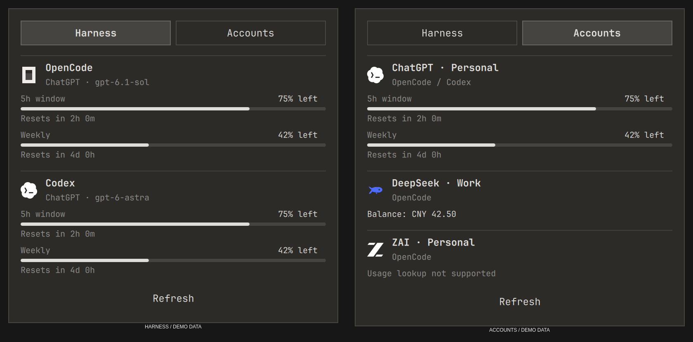

# Konousage

Part of **Konochi**, a personal Omarchy plugin series by Alec Xu.

User-owned Omarchy bar plugin derived from Omarchy's MIT-licensed agents plugin.

Two list views: **Harness** has one row per tool (OpenCode / Codex), showing
only its currently selected AI and the corresponding account's quota or balance.
**Accounts** lists each discovered account's usage, including saved inactive accounts;
it does not group by harness. There are no per-account tabs or detail pages.
Harness rows use the tool name as the primary title and AI/model as the subtitle.
Account rows use AI plus account label as the primary title (to distinguish
multiple accounts for the same AI), and list all associated harnesses underneath.
The same ChatGPT account shared across clients appears once in Accounts and is
queried once per refresh. Harness entries show shared account quota, **not** usage
attributed to that tool. OpenCode's selection is read from the first recent model
in `${XDG_STATE_HOME:-~/.local/state}/opencode/model.json` (the most recently selected
model across clients). Codex uses `$CODEX_HOME/config.toml`, including the selected
profile's model/provider overrides. This is not per-window live session tracking:
concurrent sessions can use different models, and Codex CLI model overrides are
not inferred. If selection cannot be determined, usage is shown as unknown rather
than falling back to every configured provider.
Account labels come from OpenCode; a short stable fingerprint distinguishes duplicates.
Other AI providers/API-key credentials are listed with an explicit unsupported
status, not a misleading zero. Currently supports ChatGPT OAuth quotas and
DeepSeek API-key balances (not historical spending). ZAI and other providers are
listed but their usage lookup is not yet implemented. Different API keys cannot
be identified as belonging to the same billing account, so they remain separate.
Quota percentages and meters show remaining allowance, not consumed allowance.
Click the bar icon to open; select Harness/Accounts, h/l or v to switch views,
j/k or scroll to move through the list, r to refresh, Esc to close. At 90% usage,
the icon becomes urgent. Refreshes every five minutes and when opened.

`collect.py` reads stored credentials through OpenCode V2's local
`GET /api/credential` API and Codex's `$CODEX_HOME/auth.json` (default ~/.codex).
No credential is copied or written. Expired credentials must be refreshed by their
own client. The OpenCode API command may start its background service if stopped.
Codex OS-keyring-only sign-in is not currently supported.

## Preview



## Credentials, network access, and caching

Queries https://chatgpt.com/backend-api/wham/usage with each account's own bearer
token and account header, with redirects disabled. This internal upstream endpoint
may change. Also queries the documented https://api.deepseek.com/user/balance
endpoint for DeepSeek API keys, with the same timeout, size bound and redirect refusal.
ChatGPT usage measures coding quota, not all ChatGPT chat limits. Windows are
labelled from the server's duration, not assumed to always be five hours and a week.

Only sanitized usage records and display labels are atomically cached in
`${XDG_STATE_HOME:-~/.local/state}/omarchy/ai-usage/inventory.json`, with mode 0600.
Raw account IDs and keys are replaced by one-way fingerprints. Legacy per-client
cache files are ignored. Discovery failure clears the old client/account association;
stale quota is reused only after identifying the exact same account.
On failure the panel labels last successful values as stale. Token-level local
statistics are intentionally not merged between the accounts. No OAuth refresh,
account switching, or credential writes are performed by this plugin. Cross-device
transcript syncing is not used: these are account quotas, not local token counts.

Settings: `refreshIntervalSec` in this widget's shell.json entry.
IPC: `omarchy-shell konochi.konousage refresh` (also open/close/toggle/next),
`omarchy-shell konochi.konousage view account` (or `harness`). `next` scrolls the list.

To remove from the bar: `omarchy plugin disable konochi.konousage`.

## Install and remove

Requires Omarchy Quattro, Python 3 (standard library only), and the signed-in
Codex and/or OpenCode V2 clients described above. No privileged setup or installer.

```sh
omarchy plugin add https://github.com/xvvhang/omarchy-konousage-plugin --enable
omarchy plugin disable konochi.konousage
omarchy plugin remove konochi.konousage
```

Removal leaves the sanitized usage cache in the state directory above; client
credentials are never removed. Back up unpushed development changes before removal.

## Validation

From this repository directory on Omarchy Quattro:

```sh
omarchy plugin validate .
/usr/lib/qt6/bin/qmllint -I /usr/share/omarchy/shell ./*.qml
python3 -B -m unittest discover -v
```

Use Qt 6's qmllint, not the Qt 5 executable that may be first on PATH.
MIT licensed; derived components and assets retain Omarchy's attribution in LICENSE.
